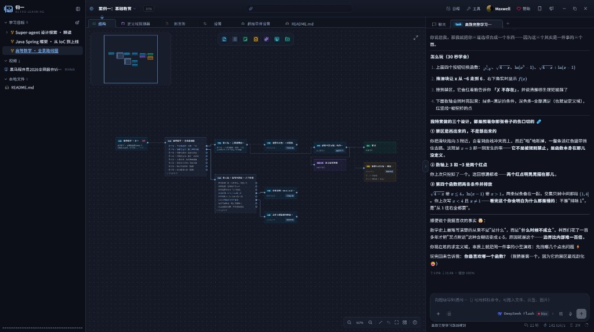
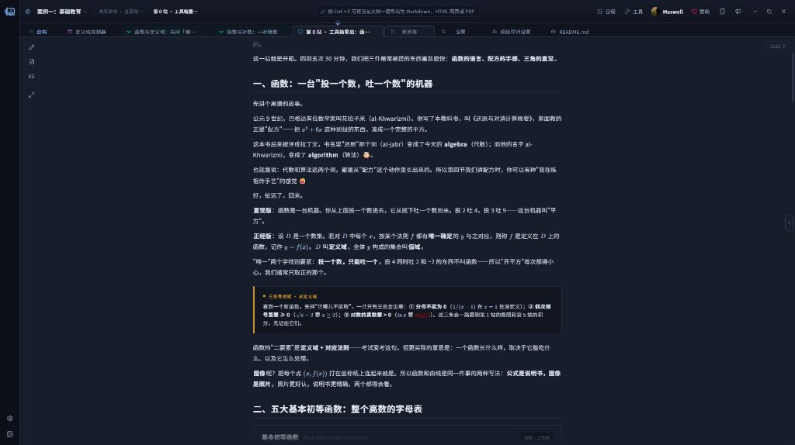
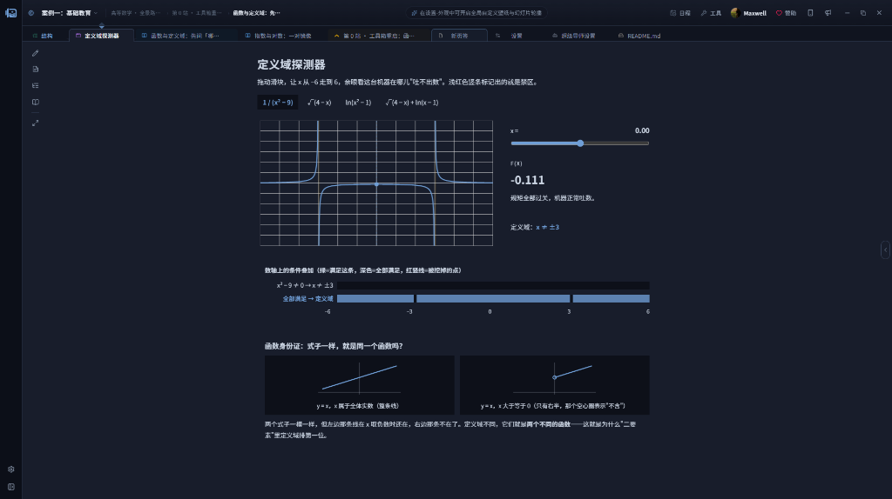
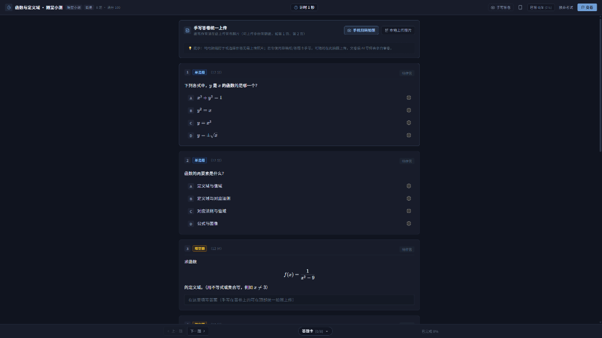
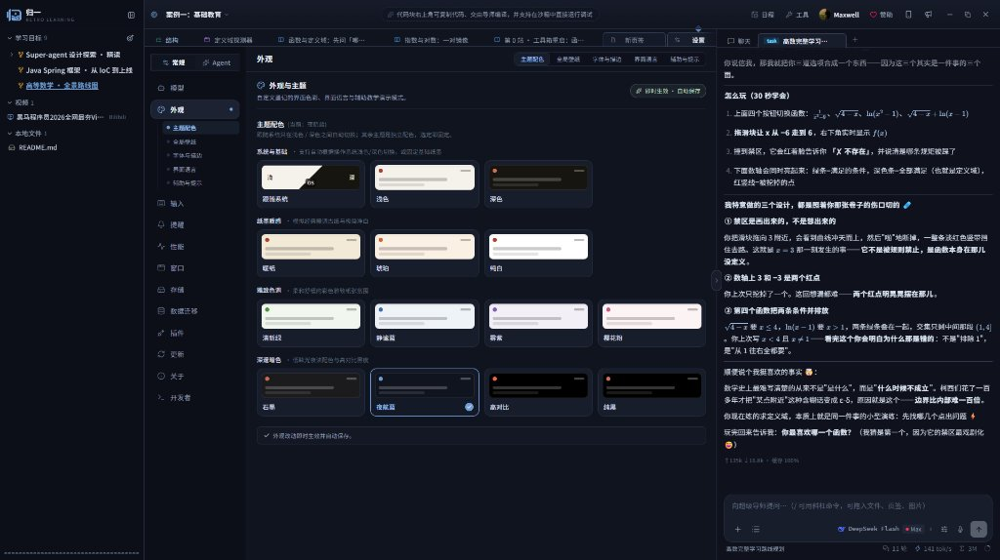

<div align="center">
  

  # 归一 Unyra · 探索式学习工作台
  
  **Local-First Agentic Learning App · 本地优先的 AI 探索式学习桌面应用**

  *从一个想弄懂的目标出发，把知识逐层拆成可探索的拓扑节点，让超级导师在讲义上为你动笔。*

  <p align="center">
    <a href="https://github.com/maplexrain/unyra/releases"></a>
    <a href="https://github.com/maplexrain/unyra/releases"></a>
    <a href="https://www.electronjs.org/"></a>
    <a href="https://react.dev/"></a>
    <a href="https://www.typescriptlang.org/"></a>
    <a href="https://tailwindcss.com/"></a>
    <a href="docs/README.md"></a>
  </p>

  [📥 下载安装包 (Releases)](https://github.com/maplexrain/unyra/releases) · [📖 项目架构文档](docs/README.md) · [💬 提交反馈与交流群](#-社区与反馈) · [❤️ 赞助支持](#-致谢与赞助)
</div>

<br />

<p align="center">
  
</p>

---

## 💡 它解决什么问题？

在通用的聊天窗口里，**学习往往是线性的、容易遗忘的**：
- 讲过的概念迅速沉入冗长的对话记录，几天后无从翻查；
- 概念之间的依赖关系错综复杂，聊天界面却只能展现单一扁平流水；
- AI 仅在输入框外部“打字陪聊”，无法沉淀出一份条理严密、能随时复习演进的讲义读物。

**归一 Unyra 将学习重构为一张清晰的「拓扑知识网」，并从根本上解决深度学习的核心痛点：**

| 维度 | 传统线性聊天 (Chat) | 归一 Unyra 探索式学习 |
| :--- | :--- | :--- |
| **知识组织** | 线性流式对话，翻页即忘，概念扁平 | **有向无环图 (DAG) 拓扑**，依赖分明，概念可被多个节点引用而不重复创建 |
| **产出载体** | 聊天气泡里的瞬时片段 | **一份活的教学文档 + 任意多份笔记**，原地持续更新，支持分屏对照与跨文档精准跳转 |
| **AI 参与度** | 仅在输入框外部打字回答 | **超级导师直接动笔**：在沙箱中执行编排，教学文档、节点结构、试卷、批注一次性落定 |
| **学习检验** | 用户主观扫读，缺乏客观反馈 | **独立全屏考试窗口 + 错题追因**，自动记录客观得分与用时，导师针对薄弱项写讲解 |
| **数据与隐私** | 存在第三方云端数据库中 | **本地优先 (Local-First)**，数据全在本地以纯 Markdown / YAML / JSON 存储，模型请求端到端直连 |

---

### 1. 讲解的细粒度如何自适应控制？（三层调节回路）

面对复杂的知识体系，AI 教学最怕“**要么泛泛而谈太浅显，要么长篇大论吓退初学者**”。Unyra 采用三层动态回路精准调节讲解细粒度：

- 🧠 **基础层 · 模型先验推演**：利用大模型的常识与逻辑推理能力，先预估该领域标准的认知进阶阶梯，自顶向下梳理概念脉络。
- 🔍 **辅助层 · 表单提问 (Ask) + 网络检索 (RAG)**：
  - **主动澄清 (`api.ask`)**：当面临认知分水岭或不确定用户水平时，导师不自作主张瞎猜，而是主动弹出一张轻量交互表单（支持单选/多选/填空）确认背景；
  - **事实检索 (`api.web.search`)**：遇到具体工程版本、前沿动态或特定事实细节时，导师自动联网检索最新资料，避免停留在抽象空谈。
- 🎯 **兜底层 · 用户探索主动拓展前置知识（选词裂变）**：
  - 没有任何算法能 100% 预判每个人知识盲区。当用户在讲义中读到某个未掌握的前提概念时，**鼠标选词按数字键 `1`**，系统即可在当前节点下裂变出一个子节点展开专向讲解；
  - 学懂前置知识后，顺着拓扑图随时退回主线。**把控学习深度与节奏的终极权力，始终在学习者手中**。

---

### 2. 教学文档的权威性与真实性如何保障？

避免大模型“一本正经地胡说八道”（幻觉），是进阶严肃学习的生命线：

- ⚖️ **直觉与严谨「双轨制」排版**：正文严格遵守教学规律，**先以通俗生活隐喻建立直觉（怎么想），紧随严格的数学/工程标准定义与边界约束（公式与严格判定），最后标出易错禁区**。绝不因通俗而偷换概念，兼顾好懂与权威。
- 💻 **代码沙箱本地真实编译运行**：讲义中的代码片段不是不可运行的“死文本”。在超级导师的编排下，代码块支持一键在**本地隔离沙箱**中转译与真实执行，输出结果直接挂在代码块下方，经得起实操检验。
- 📚 **规范公式与事实来源透明**：全篇公式走标准 KaTeX 语法（主流 Markdown 编辑器原生兼容）；检索引述保留来源 URL；再由**独立全屏考场**的客观计算题反向检验掌握成色，彻底打破模型幻觉。

---

### 3. 教学内容如何为用户量身特化？（用户画像与双层记忆）

千人一面的教材无法满足不同背景的学习者。Unyra 内置了不破坏大模型前缀缓存的高效个性化系统：

- 👤 **客观画像 (`user.yaml`)**：记录学习者的学历层次、专业背景、已有技能与偏好语言。画像信息作为客观背景首轮注入或按需读取，**不污染系统提示词**，避免改动个人信息导致全量前缀缓存失效。
- 📝 **无感提问与直写画像**：导师通过 `api.ask` 询问学习者的偏好或水平，用户提交表单的瞬间，数据直接校验并增量落盘至 `user.yaml`，不经由大模型二次复述，杜绝信息走样。
- 🧠 **双层记忆网络 (Memory System)**：
  - **工作记忆 (`mind.json`)**：记录当前目标内部的研讨进展、待办事项与专属约定；
  - **长期记忆 (`state.json`)**：跨学习目标记录用户的认知习惯、高频薄弱项与个性特征。
- 💡 **心智模型动态映射**：当面对同一个“函数”概念时，面对计算机背景的学习者，导师会类比为“映射与接口契约”；面对文科背景的学习者，则类比为“投币自动售卖机”，因材施教。

---

## 🎯 典型学习场景

### 场景 1：复杂学科与概念拆解（以《高等数学》为例）
> **从直觉到严谨定义，建立系统性认知，告别死记硬背。**

1. **结构化展开路线**：输入目标后，导师根据知识依赖生成全景路线图（如：从“工具箱早启：函数”到“函数与定义域”，再延伸至极限与导数），节点层级清晰，配有 Minimap 导航缩略图。
2. **先讲直觉，再讲原理**：导师在教学文档中动笔撰写讲义，用“投一个数，吐一个数的机器”通俗破题，再给出严谨的数学定义，并标注求定义域的关键禁区。

<p align="center">
  
</p>

3. **交互式辅助理解（超级文档）**：导师还可编写带有动态图表和滑动控件的交互页面（例如“定义域探测器”），拖动滑块即可直观观察函数在禁区附近的变化曲线与未定义点，让抽象概念跃然眼前。

<p align="center">
  
</p>

4. **选词即学，逐层深潜**：阅读讲义时若遇到生疏术语，鼠标高亮选词，按数字键 `1` 即可在当前节点下裂变子节点展开细讲，按 `2` 由导师在正文划出两三句行内注解。

---

### 场景 2：随堂练习与客观自测（独立考试窗口）
> **检验学没学会，用客观判分与错题讲解形成完整闭环。**

1. **一键发起考试**：针对当前节点生成的随堂小测，在**独立的沉浸窗口**中作答。
2. **纯粹防干扰卷面**：单栏清晰排版，题目与选项支持标准 LaTeX 数学公式渲染；支持单选题、填空题以及手写草稿答卷上传。

<p align="center">
  
</p>

3. **智能阅卷与薄弱项追因**：交卷后客观题本地自动判分，主观题由导师批阅；导师对照历史错题归纳易错点，并在那次考试副本中附上详细的错题讲解，反复考的成绩天然成组对比。

---

## 🌟 核心功能特性

### 🗺️ 结构画布与知识拓扑 (Structure Canvas)
- **概念拓扑图谱 (DAG)**：知识拆解为独立节点，节点间建立明确依赖边。同一个核心概念可被多个上层知识点引用，避免重复构建。
- **流畅平移与缩放**：画布支持大范围缩放与平移，附带实时 Minimap 导航小地图，方便宏观总览与微观阅读快速切换。
- **自动适配任务类型**：系统性学习生成多层级完整大纲树；对于阅读代码库、查阅报错或单点答疑等临时任务，只建根节点导读文档，不制造多余的空节点。

---

### 🧑‍🏫 超级导师与动态讲义 (Super Agent)
- **一个目标一份上下文**：同一目标下的所有节点共享对话上下文，切节点不丢失历史，保持模型前缀缓存高效稳定。
- **代码沙箱直接动笔**：导师通过 JavaScript 沙箱统一操作文档读写、节点管理与试卷编排，讲解内容直接写入教学文档，并在对话中说明修改理由。
- **思考链可见与智能跟随**：思考气泡实时滚动显示生成过程；输出时窗口自动贴底，向上翻阅时自动解除跟随，不打扰阅读节奏。
- **上下文智能压缩**：长对话自动或手动生成交接摘要与未完待办清单，淘汰旧消息残渣，关键约定永不遗忘。
- **三种导师人格随心切**：
  - **标准导师**（默认）：耐心引导，先直觉后原理；
  - **简洁导师**：直奔主题，只讲核心逻辑与解法；
  - **ADHD 导师**：充满好奇，主线穿插趣味支线，善用 emoji 辅助视觉标记。

---

### ⚡ 选词即学与快捷交互
- **1~4 数字盲操快捷菜单**：在文档中选中文本即可唤出菜单，按数字键直接触发：
  - `1 学习`：在当前节点下创建子节点并自动开讲；
  - `2 了解`：导师在正文中划定两三句上下文相连的行内释义注解；
  - `3 注解`：添加用户个人的 Markdown 批注；
  - `4 询问`：精准定位原句向导师发起深度提问。
- **复制的是 Markdown 原文**：阅读视图中按下 `Ctrl+C`，存入剪贴板的是纯净标准的 Markdown 源码（公式与标记均保持原样）。
- **精准行号跳转**：支持 `moji:doc/#节点id/note#L12-L20` 语法，点击即可自动滚屏并高亮对应行段。

---

### 📑 自由分屏工作区与文档能力
- **VS Code 级多区分屏**：页签支持任意拖动排序、左右并排或上下叠放分割；各分屏具备独立页签管理与焦点记忆。
- **数学公式与图表**：内置 KaTeX 数学排版（零字体网络依赖），支持用 ```` ```plot ```` 围栏动态绘制函数解析图像。
- **代码块高亮与沙箱运行**：集成 VS Code TextMate 40+ 语言语法高亮，代码块支持一键在隔离沙箱中编译执行并查看输出。
- **PDF 预览与本地 OCR**：支持 PDF 文件高清矢量阅读，内置 PaddleOCR / 系统文字识别覆盖层，轻松进行划词、提取与问答。
- **本地离线语音输入**：集成 SenseVoiceSmall 离线语音模型（228MB），按住空格即可转写，音频不出本机。
- **多格式导出**：`Ctrl+E` 一键导出整洁 Markdown、单文件 HTML 网页或 PDF 文档。

---

### 🎨 13 套精心调优的主题配色
文档与界面的视觉设计深度打磨，代码高亮配色随主题同步变换，无论是深夜自习还是白天阅读，都能提供舒适沉浸的视觉体验：

<p align="center">
  
</p>

- **浅色系**：浅色、暖纸、琥珀、纯白；
- **深色系**：深色、石黑、夜航蓝、高对比、纯黑；
- **雅致色系**：演变绿、静谧蓝、霁紫、樱花粉。

---

## 🔒 本地优先与隐私安全 (Local-First)

**所有学习数据与讲义均保存在本机用户数据目录下，不经过任何第三方云端。**

```
%APPDATA%/unyra/users/{uid}/
├── user.yaml            # 用户画像与基本设置
├── setting.yaml         # 外观、快捷键、AI 接入配置
├── state.json           # 界面状态（打开的页签、分屏、未保存暂存）
├── docs/{目标名}/       # 纯文本 Markdown 教学文档、多份笔记、考试试卷
└── web/                 # 离线归档的参考网页
```

- **纯明文文件存储**：讲义与笔记均为标准 `.md` 文件，不锁死在专属数据库中。可随时使用外部编辑器打开或备份至移动硬盘。
- **AI 请求端到端直发**：由 Electron 本地主进程直接与您配置的服务商进行通信，绝无中间代理服务器。

---

## 🚀 快速开始

### 1. 下载安装包
请前往 [GitHub Releases 发布页](https://github.com/maplexrain/unyra/releases) 获取：
- **`Unyra-Setup-<版本>.exe`**：标准 Windows 安装向导（推荐，自动处理更新与桌面快捷方式，无需管理员权限）。
- **`win-unpacked.zip`**：便携版，解压后双击 `归一 Unyra.exe` 即可直接运行。

### 2. 填入 API Key 即可使用
1. 启动应用，选择或新建一个本机用户；
2. 点击顶栏右上角 **设置 (⚙️)**，在 AI 设置中填入您的 API Key（默认支持 DeepSeek 官方接口，也可配置任意兼容 OpenAI 协议的服务，如通义千问、Kimi、GLM、本地 Ollama 等）；
3. 点击左侧 **新建目标**，输入您想要学习的课题，导师将即刻为您生成路线并开讲！

---

## 💻 本地开发

```bash
# 1. 克隆仓库
git clone https://github.com/maplexrain/unyra.git
cd unyra

# 2. 安装依赖
npm install

# 3. 安装 Electron 运行环境
node node_modules/electron/install.js

# 4. 启动开发模式（支持热重载）
npm run dev

# 5. 运行完整测试套件
npm run test

# 6. 代码检查与打包
npm run lint
npm run typecheck
npm run build
npm run release:win
```

> [!TIP]
> 国内网络如遇 GitHub 二进制包下载缓慢，可在 PowerShell 中配置镜像：  
> `$env:ELECTRON_MIRROR="https://cdn.npmmirror.com/binaries/electron/"`

---

## 🏗️ 核心技术栈

- **桌面核心**：[Electron 44](https://www.electronjs.org/) · Node.js 24 · ESBuild
- **前端架构**：[React 19](https://react.dev/) · [TypeScript 7](https://www.typescriptlang.org/) · [Vite 8](https://vite.dev/) · [Tailwind CSS 4](https://tailwindcss.com/) · Anime.js · Lucide Icons
- **编辑器与排版**：CodeMirror 6 · VS Code TextMate / Oniguruma · Marked · [KaTeX](https://katex.org/) · FunctionPlot
- **端侧 AI 运行时**：ONNX Runtime Node · PaddleOCR · Sherpa-ONNX (SenseVoiceSmall) · PDF.js

---

## 💬 社区与反馈

如果您在学习与使用过程中遇到问题，或有好的产品建议，欢迎交流：

- 🐛 **Issue 反馈**：[提交 GitHub Issue](https://github.com/maplexrain/unyra/issues)
- 💬 **归一交流群**：`851412626`
- 📺 **B站主页**：[@岚中古桥](https://space.bilibili.com/234503788)
- 📮 **作者 QQ**：`2652079974`

---

## ❤️ 致谢与赞助

归一由作者全职独立开发，负责从架构、代码、文档到发布的全部工作。每一位朋友的认可与赞助，都是支撑项目持续前进的坚实动力。

在此**特别鸣谢**首位赞助者 **瑞宝** 与所有支持归一的朋友！

👉 **[查看完整赞助者名单与致谢记录 (持续更新)](docs/sponsors.md)**

---

<div align="center">
  <sub>Made with ❤️ by <a href="https://github.com/maplexrain">maplexrain</a>. Empowered by Open Source.</sub>
</div>
